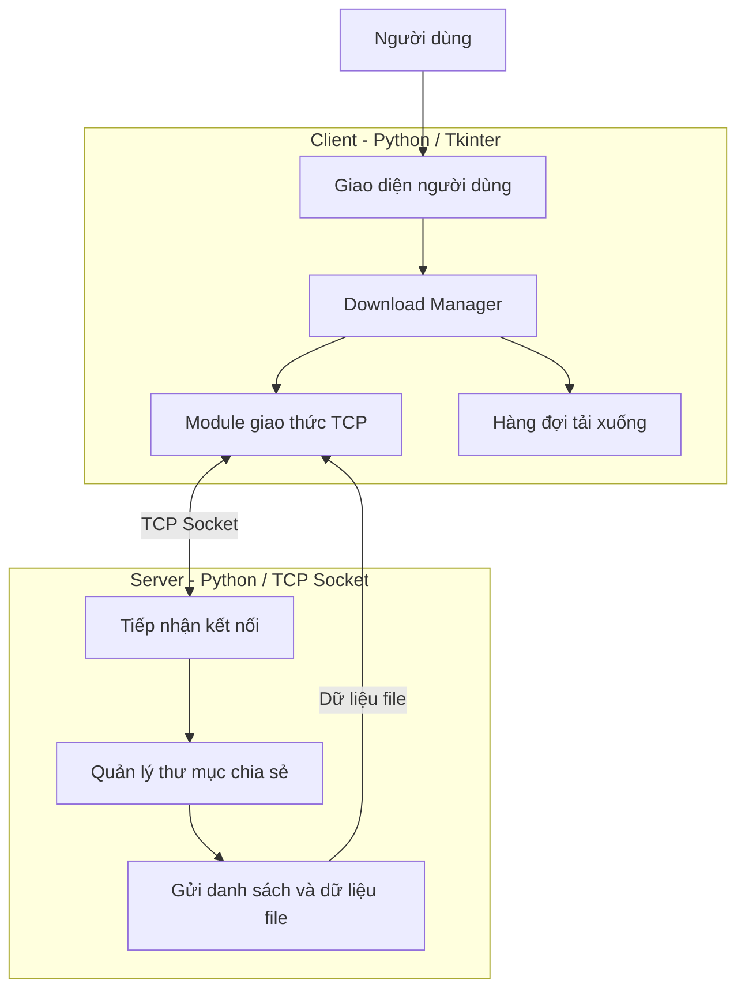

# 📥 UDM_11 — Download nhiều file qua mạng TCP

<p align="center">
  <strong>Ứng dụng tải nhiều tệp từ Server về Client sử dụng TCP Socket</strong>
</p>

<p align="center">
  
  
  
  
</p>

---

## 📌 1. Thông tin đề tài

| Nội dung | Thông tin |
|---|---|
| **Tên đề tài** | Download nhiều file |
| **Mã đề tài** | `UDM_11` |
| **Lĩnh vực** | Lập trình mạng |
| **Ngôn ngữ** | Python 3 |
| **Giao thức mạng** | TCP Socket |
| **Giao diện** | Tkinter |
| **Thời gian thực hiện** | 4 tuần |
| **Số lượng thành viên** | 6 |

## 👥 2. Danh sách thành viên

> Cập nhật họ tên và mã số sinh viên của các thành viên trước khi nộp bài.

| STT | Họ và tên | MSSV | Phụ trách |
|:---:|---|---|---|
| 1 | `[Họ tên thành viên 1]` | `[MSSV]` | Xây dựng Server |
| 2 | `[Họ tên thành viên 2]` | `[MSSV]` | Giao thức TCP và truyền file |
| 3 | `[Họ tên thành viên 3]` | `[MSSV]` | Thiết kế giao diện Client |
| 4 | `[Họ tên thành viên 4]` | `[MSSV]` | Quản lý hàng đợi và tải nhiều file |
| 5 | `[Họ tên thành viên 5]` | `[MSSV]` | Tích hợp và kiểm thử |
| 6 | `[Họ tên thành viên 6]` | `[MSSV]` | Điều phối, tài liệu và demo |

## 🎯 3. Giới thiệu dự án

**UDM_11 – Download nhiều file** là ứng dụng Client–Server cho phép người dùng kết nối đến Server thông qua địa chỉ IP và cổng TCP, xem danh sách tệp được chia sẻ và tải nhiều tệp về máy tính.

Dự án tập trung vào việc truyền dữ liệu tin cậy qua TCP, quản lý nhiều tác vụ tải xuống và cập nhật tiến độ theo thời gian thực trên giao diện người dùng.

### ✨ Chức năng chính

- 🔌 Kết nối Client đến Server bằng địa chỉ IP và port.
- 📂 Hiển thị danh sách tệp có trên Server.
- 📥 Chọn và tải xuống nhiều tệp.
- 📊 Theo dõi trạng thái, tốc độ và tiến độ của từng tệp.
- ⚙️ Quản lý hàng đợi, tối đa **2 tệp tải đồng thời**.
- 🛡️ Xử lý lỗi riêng cho từng lượt tải; một tệp lỗi không làm dừng các lượt tải khác.
- 📝 Xử lý trường hợp tên tệp tải xuống bị trùng theo quy tắc được thống nhất.

**Phạm vi:** Phiên bản này không bao gồm chức năng tạm dừng hoặc tiếp tục tải xuống (Pause/Resume).

## 🏗️ 4. Kiến trúc hệ thống

Ứng dụng được xây dựng theo mô hình **Client–Server**, sử dụng TCP Socket để trao đổi thông điệp và truyền dữ liệu tệp.



### 🔄 Quy trình hoạt động

1. Người dùng khởi chạy Server và cấu hình thư mục chứa các tệp được chia sẻ.
2. Người dùng mở Client, nhập IP và port của Server rồi kết nối.
3. Client gửi yêu cầu lấy danh sách tệp.
4. Server trả về danh sách các tệp có thể tải.
5. Người dùng chọn nhiều tệp và đưa chúng vào hàng đợi.
6. Download Manager điều phối các lượt tải, tối đa 2 lượt đồng thời.
7. Client cập nhật trạng thái, tốc độ và tiến độ của từng tệp.
8. Khi hoàn thành hoặc xảy ra lỗi, Client hiển thị kết quả tương ứng.

## 🧰 5. Công nghệ sử dụng

| Công nghệ | Vai trò |
|---|---|
| **Python 3** | Ngôn ngữ lập trình chính |
| **socket** | Kết nối và truyền dữ liệu qua TCP |
| **threading / concurrent.futures** | Xử lý các tác vụ tải nền |
| **queue** | Trao đổi thông tin giữa các luồng khi cần |
| **Tkinter** | Xây dựng giao diện đồ họa |
| **hashlib** *(nếu triển khai)* | Kiểm tra tính toàn vẹn của tệp |
| **Git & GitHub** | Quản lý phiên bản và cộng tác nhóm |

Các module `socket`, `threading`, `queue`, `json` và `hashlib` thuộc thư viện chuẩn Python, không cần cài riêng bằng `pip`.

## 💻 6. Yêu cầu môi trường

- Python **3.x** tương thích với mã nguồn của dự án.
- VS Code hoặc IDE Python tương đương.
- Git để lấy mã nguồn và quản lý phiên bản.
- Tkinter hoạt động trên môi trường Python đang sử dụng.
- Máy chạy Client và Server có thể giao tiếp qua mạng TCP.
- Cho phép kết nối đến port Server đã cấu hình; nếu chạy trên hai máy, cần kiểm tra tường lửa và cấu hình mạng.

### Kiểm tra môi trường

```bash
python --version
python -m tkinter
git --version
```

Nếu lệnh `python` không hoạt động trên Windows, thử `py --version`.

## 🚀 7. Cài đặt và chạy chương trình

### Bước 1 — Tải mã nguồn

```bash
git clone <GITHUB_REPOSITORY_URL>
cd <PROJECT_FOLDER>
```

Thay `<GITHUB_REPOSITORY_URL>` bằng URL repository thực tế và `<PROJECT_FOLDER>` bằng tên thư mục dự án.

### Bước 2 — Tạo môi trường ảo (khuyến nghị)

```bash
python -m venv .venv
```

**Windows:**

```bash
.venv\Scripts\activate
```

**macOS / Linux:**

```bash
source .venv/bin/activate
```

### Bước 3 — Cài đặt thư viện

Nếu dự án có file `requirements.txt`:

```bash
python -m pip install -r requirements.txt
```

Nếu dự án chỉ dùng thư viện chuẩn Python và Tkinter, không cần cài thêm thư viện bên ngoài. Chỉ cài các gói tùy chọn khi mã nguồn thực tế có sử dụng chúng.

### Bước 4 — Cấu hình Server

- Xác định địa chỉ IP và port mà Server sẽ lắng nghe.
- Chuẩn bị thư mục chứa các tệp cho phép tải xuống.
- Đảm bảo Client có thể kết nối đến địa chỉ và port đã cấu hình.
- Không sử dụng thư mục chia sẻ chứa dữ liệu riêng tư hoặc tệp không được phép công khai.

### Bước 5 — Khởi chạy Server

Ví dụ, nếu file khởi chạy Server là `server/server.py`:

```bash
python server/server.py
```

### Bước 6 — Khởi chạy Client

Mở một Terminal khác tại thư mục dự án. Ví dụ, nếu file khởi chạy Client là `client/main.py`:

```bash
python client/main.py
```

> **Lưu ý:** Đường dẫn và tên file ở bước 5–6 là ví dụ. Hãy thay bằng tên file khởi chạy thực tế của nhóm.

### Bước 7 — Sử dụng ứng dụng

1. Khởi chạy Server.
2. Mở Client và nhập IP, port của Server.
3. Nhấn **Connect** để kết nối.
4. Xem danh sách tệp được chia sẻ.
5. Chọn một hoặc nhiều tệp cần tải.
6. Theo dõi trạng thái, tốc độ và phần trăm hoàn thành.
7. Kiểm tra các tệp sau khi tải xuống.

## ⚙️ 8. Cấu hình chương trình

Các thông số dưới đây cần được nhóm thống nhất và cập nhật theo mã nguồn thực tế.

| Thông số | Ý nghĩa |
|---|---|
| `SERVER_HOST` | Địa chỉ IP mà Server lắng nghe |
| `SERVER_PORT` | Port TCP của Server |
| `SHARED_DIR` | Thư mục chứa tệp được chia sẻ |
| `DOWNLOAD_DIR` | Thư mục lưu tệp tải xuống trên Client |
| `MAX_CONCURRENT_DOWNLOADS` | Số lượt tải đồng thời tối đa, dự kiến là `2` |

Không thay đổi tên biến cấu hình nếu chúng chưa tồn tại trong mã nguồn; hãy đối chiếu với cách cấu hình thực tế của dự án.

## 📁 9. Cấu trúc thư mục dự kiến

```text
UDM_11/
├── client/
│   ├── main.py
│   ├── gui.py
│   └── download_manager.py
├── server/
│   └── server.py
├── common/
│   └── protocol.py
├── shared_files/
├── downloads/
├── tests/
├── README.md
└── requirements.txt
```

Đây là cấu trúc tham khảo. Nhóm có thể điều chỉnh tùy theo cách tổ chức mã nguồn, nhưng nên giữ rõ ràng phần Client, Server, giao thức dùng chung và kiểm thử.

## 🧪 10. Kiểm thử và tiêu chí nghiệm thu

| STT | Trường hợp kiểm thử | Kết quả mong đợi |
|:---:|---|---|
| 1 | Client kết nối Server đúng IP/port | Kết nối thành công |
| 2 | Yêu cầu danh sách tệp | Hiển thị đúng danh sách |
| 3 | Tải một tệp | Tệp được lưu đúng nội dung |
| 4 | Tải nhiều tệp | Các tệp được xử lý theo hàng đợi |
| 5 | Theo dõi tiến độ | Mỗi tệp có trạng thái và tiến độ riêng |
| 6 | Tải nhiều tệp đồng thời | Không vượt quá giới hạn 2 lượt |
| 7 | Một tệp xảy ra lỗi | Các lượt tải khác vẫn tiếp tục |
| 8 | Tên tệp đích bị trùng | Xử lý theo quy tắc đã thống nhất |
| 9 | Kiểm tra dữ liệu sau tải | Kích thước hoặc checksum khớp nếu có kiểm tra |
| 10 | Tải tệp dung lượng lớn | Giao diện vẫn phản hồi |

## 🗓️ 11. Kế hoạch thực hiện

| Tuần | Nội dung | Kết quả |
|:---:|---|---|
| **Tuần 1** | Phân tích yêu cầu, thiết kế kiến trúc, thống nhất giao thức TCP | Đặc tả và cấu trúc dự án |
| **Tuần 2** | Xây dựng Server, Client, liệt kê và tải một tệp | Chức năng cơ bản hoạt động |
| **Tuần 3** | Hàng đợi tải, tải nhiều tệp, trạng thái và tiến độ | Hoàn thành chức năng chính |
| **Tuần 4** | Tích hợp, kiểm thử, sửa lỗi, hoàn thiện báo cáo và demo | Sản phẩm hoàn chỉnh |

## ⚠️ 12. Lưu ý khi sử dụng

- Server chỉ nên chia sẻ các tệp được phép truy cập.
- Cần kiểm tra đường dẫn để tránh truy cập tệp ngoài thư mục chia sẻ.
- Không để tác vụ mạng chặn luồng giao diện Tkinter.
- Xử lý lỗi theo từng lượt tải để hạn chế ảnh hưởng đến các tệp khác.
- Không ghi đè tệp đích khi chưa áp dụng quy tắc xử lý tên trùng.
- Chỉ sử dụng trên hệ thống và mạng mà người dùng có quyền truy cập.

## 📚 13. Tài liệu tham khảo

- Python: https://www.python.org/
- Python Socket Programming: https://docs.python.org/3/library/socket.html
- Python Tkinter: https://docs.python.org/3/library/tkinter.html
- Python Threading: https://docs.python.org/3/library/threading.html
- Git: https://git-scm.com/
- GitHub: https://github.com/

---

<p align="center">
  <strong>UDM_11 — Download nhiều file qua mạng TCP</strong><br>
  <sub>Đồ án môn Lập trình mạng · Python · TCP Socket</sub>
</p>
